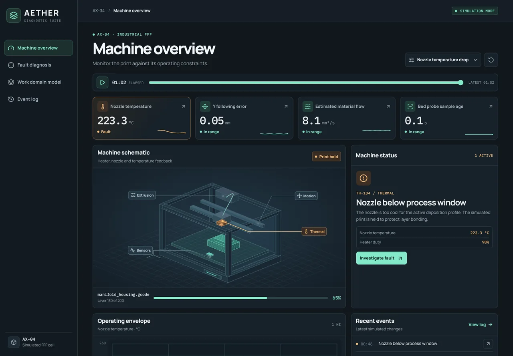

# Aether Diagnostic Suite

**DES640 · Ecological Interface Design for an Industrial 3D Printer**

Aether is an operator console for a simulated industrial fused filament fabrication (FFF) cell. The interface makes process limits visible beside the signals they constrain, locates affected subsystems on a machine schematic, and lets operators follow evidence from a machine-level warning to a corrective action and recovery check.



## Run locally

Use Node.js 20.19+ or 22.12+.

```sh
npm ci
npm run dev
```

`npm run build` type-checks and produces a static site in `dist/`. `npm run preview` serves the production build locally.

## Try the diagnostic workflow

1. Open **Machine overview**. The default replay shows a nozzle temperature fault. Compare the measured temperature with its process window and use the schematic or metric cards to select a subsystem.
2. Open **Investigate fault**. Review observed signals, the explanations they support, and the measurements that are missing. Acknowledge the fault or apply the scenario’s simulated recovery.
3. Verify recovery in **Operating envelope** and **Event log**. A fault requires four consecutive samples satisfying its detection rule. Clearing a fault requires four consecutive samples satisfying its recovery rule. Acknowledging a fault leaves the hold in place.
4. Open **Work domain model** and select a node. The trace above the node gives the purpose it serves. The trace below gives the means that implement it, including cross-subsystem dependencies.

The scenario selector includes nominal printing, insufficient nozzle heat delivery, Y-axis following error, a material feed restriction, and a stale bed temperature probe. Restart a replay to see the fault develop from steady state. Scrubbing the timeline reviews recorded samples and disables action until you return to the latest sample.

| Scenario | Signals to compare | Recovery evidence |
| --- | --- | --- |
| Nozzle temperature drop | Temperature below the process window, high heater duty, and agreement between two probes | Temperature returns within the window and probes agree |
| Y-axis tracking drift | Following error exceeds positional tolerance while flow and temperature remain stable | Following error stays at or below the limit |
| Material feed restriction | Flow below demand with increasing drive load and stable nozzle temperature | Flow returns within the window and drive load drops |
| Stale bed probe | Primary sample age grows while the held primary value looks plausible and the reference reports | Primary updates resume and sample age stays within the limit |

## Work Domain Analysis

The six-level hierarchy in [`src/domain.ts`](src/domain.ts) is a project-specific refinement of the abstraction hierarchy. It links each higher-level need to the lower-level means that support it.

| Level | Example for thermal control | Interface representation |
| --- | --- | --- |
| Functional purpose | Produce a bonded part | Fault impact on the print |
| Values and priorities | Maintain the nozzle process window | Shaded band, target and limit labels |
| Generalized processes | Condition the polymer | Process description and links to sensor feedback |
| Subsystem functions | Regulate hotend heat | Compare thermal error, heater duty and reference readings |
| Physical components | Heater block and probes | Schematic locator and candidate explanations |
| Physical form and state | Temperature and duty readings | Current measurements and replay history |

`src/model.ts` defines deterministic one-hertz samples, per-subsystem evidence, fault and recovery predicates, and derived events. `src/visuals.tsx` renders the machine view and readable signal envelopes. All telemetry, operating limits, and recovery actions are for the simulator. The app has no machine connection. The overview-to-diagnosis flow is designed to reduce the amount of inference an operator must do. Its effect on cognitive load was not measured with operators.

[Kim J. Vicente and Jens Rasmussen, *Ecological Interface Design: Theoretical Foundations*](https://ritter.ist.psu.edu/misc/dirk-files/Papers/HCI/Ecologicalinterfacedesign.pdf)
